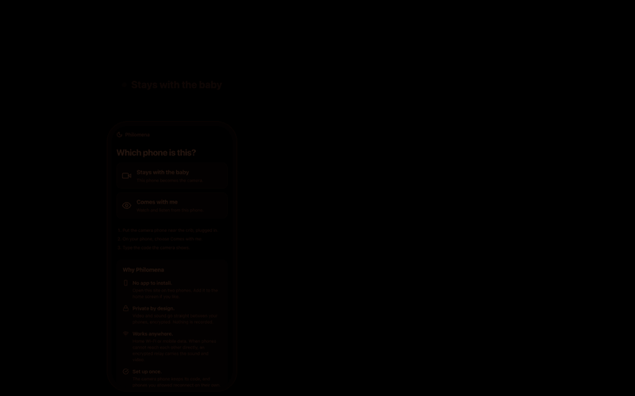

# Philomena

A baby monitor from two phones. One phone stays with the baby and is the camera. Other phones and laptops watch it in the browser. Nobody installs an app.



How it is used:

1. The phone by the crib opens the site and taps "Stays with the baby". It shows a QR code and a 6-digit code.
2. Your phone scans the code. The camera phone taps "Allow". The next night, the two phones find each other again.
3. The app stays dark at night. The camera phone listens, and your phone shows one word: "Calm", "Stirring", or "Crying".
4. A cry wakes your phone with a notification, even when it is locked. One tap shows the picture.

Philomena is meant to be self-hosted. You run it on your own server, under your own domain. This guide uses `monitor.example.com` for the domain and `203.0.113.10` for the server's public IP address. Put your own values in their place.

## How it works

- **The phones carry the call.** Video, sound, talk-back, alerts, and the night history go from phone to phone over WebRTC, encrypted end to end. Nothing is recorded.
- **The server is the meeting point.** It serves the pages, passes the WebRTC handshake between the phones, keeps the approvals, and sends the push notifications. A call that is already connected keeps running when the server restarts. A phone needs the server again only to reconnect.
- **The relay (TURN) is for hard networks.** When two phones cannot reach each other directly, for example a phone on mobile data, coturn relays the media. The relay sees only encrypted packets.

```text
phone (camera) ──── WebRTC, direct or through coturn ──── phone (viewer)
       │                                                       │
       └──── HTTPS: pages, handshake, approvals, push ─────────┘
                              │
                    Caddy → Philomena app (SQLite)
                    coturn (TURN, UDP and TCP 3478)
```

The server stores:

- `philomena.sqlite3`: rooms (the 6-digit code and a hash of the camera's key), the phones allowed to watch, camera names, and push subscriptions.
- `vapid.pem`: the key that signs the push notifications. The app makes it on the first start.

The night history stays on the camera phone, in its browser storage.

## What you need

- A Linux server with a public IPv4 address. A small VM is enough: the app uses little CPU, and the relay carries media only when a direct path fails.
- A domain name, with an `A` record that points at the server. Phones allow the camera and the microphone only over HTTPS, so the app must run behind a TLS proxy. Caddy gets the certificate for you.
- These ports, open to the internet:

  | Port | For |
  | --- | --- |
  | 80/tcp, 443/tcp | HTTPS (Caddy) |
  | 3478/udp, 3478/tcp | TURN |
  | 49160-49199/udp | TURN relay |

  ```sh
  ufw allow 80/tcp
  ufw allow 443/tcp
  ufw allow 3478/udp
  ufw allow 3478/tcp
  ufw allow 49160:49199/udp
  ```

  If your cloud provider has its own firewall, open the same ports there.

## Settings

The app and coturn read the same settings.

| Key | Needed | Value |
| --- | --- | --- |
| `PUBLIC_URL` | yes | The HTTPS address of your install, `https://monitor.example.com`. Link previews and Web Push use it. The default, `http://localhost:8000`, is only for development. |
| `COTURN_STATIC_AUTH_SECRET` | for TURN | A long random value: `openssl rand -hex 32`. The app signs short-lived TURN logins with it, and coturn checks them. |
| `TURN_PUBLIC_IP` | for TURN | The server's public IPv4, `203.0.113.10`. coturn listens on it. |
| `TURN_URLS` | for TURN | `turn:monitor.example.com:3478?transport=udp,turn:monitor.example.com:3478?transport=tcp` |
| `STUN_URLS` | no | `stun:monitor.example.com:3478` uses your own coturn. The default is Google's public STUN server. |
| `TURN_TTL` | no | The lifetime of a TURN login in seconds. The default is `86400`. |
| `OFFLINE_PUSH_AFTER` | no | Seconds of silence before the "camera offline" push. The default is `60`. |

The app offers TURN only when `TURN_URLS` and `COTURN_STATIC_AUTH_SECRET` are both set. Without TURN, two phones on the same Wi-Fi connect. A phone on mobile data can fail.

## Deploy with Yard

[Yard](https://github.com/stariodev/yard) deploys an app from `git push`. It runs the app with Podman and puts Caddy with HTTPS in front of it. It reads this repo's `compose.yml`, which has two services: `app` (Philomena) and `turn` (coturn on the host network).

1. **Set up Yard** on the server. Its README has the steps. Then connect your machine to Yard with `yard login` and connect a forge with `yard forge setup`.
2. **Point DNS** for `monitor.example.com` at the server, and open the ports above.
3. **Push your copy** of this repo to a repository that Yard can read.
4. **Create the app** from your checkout:

   ```sh
   yard app new --caddy monitor.example.com \
     -e PUBLIC_URL=https://monitor.example.com \
     -e COTURN_STATIC_AUTH_SECRET=$(openssl rand -hex 32) \
     -e TURN_PUBLIC_IP=203.0.113.10 \
     -e 'TURN_URLS=turn:monitor.example.com:3478?transport=udp,turn:monitor.example.com:3478?transport=tcp' \
     -e STUN_URLS=stun:monitor.example.com:3478
   ```

   Yard builds `Containerfile` and starts both services. Then it writes the Caddy site for `monitor.example.com`. `yard caddy edit` changes that site later.

5. **Check** the deploy:

   ```sh
   curl https://monitor.example.com/health    # 200
   yard app status --app philomena
   yard logs philomena-turn-1                 # the coturn log
   ```

Yard names the app after the repo. If your repo has another name, use that name in place of `philomena`.

**Updates:** push to `main`. Yard deploys each push. Change a setting with `yard env set KEY=VALUE --app philomena`. Yard keeps the old settings until the next deploy, so then run `yard app deploy --app philomena`.

## Deploy with Docker Compose or Podman Compose

You can run the same `compose.yml` without Yard. Yard fills a few variables in it, so you set them yourself.

1. **Point DNS** for `monitor.example.com` at the server, and open the ports above.
2. **Clone the repo** on the server, and go into it.
3. **Make `compose.env`.** Compose fills the variables in `compose.yml` from this file:

   ```sh
   PROJECT_NAME=philomena
   IMAGE=philomena:local
   SHA=local
   CHECKOUT=.
   DATA_DIR=/srv/philomena/data
   APP_ENV=./app.env
   ```

4. **Make `app.env`** with the settings from the table:

   ```sh
   PUBLIC_URL=https://monitor.example.com
   COTURN_STATIC_AUTH_SECRET=<openssl rand -hex 32>
   TURN_PUBLIC_IP=203.0.113.10
   TURN_URLS=turn:monitor.example.com:3478?transport=udp,turn:monitor.example.com:3478?transport=tcp
   STUN_URLS=stun:monitor.example.com:3478
   ```

5. **Publish the app port** to the server only. Make `compose.override.yml`:

   ```yaml
   services:
     app:
       ports:
         - "127.0.0.1:8000:8000"
   ```

6. **Start** it:

   ```sh
   mkdir -p /srv/philomena/data
   docker network create yard
   docker compose --env-file compose.env up -d --build
   ```

   The service file names the network `yard`, so the network must exist. The name has no other meaning. With Podman, use `podman network create yard` and `podman compose`.

7. **Check** it: `curl http://127.0.0.1:8000/health` returns 200, and `docker compose --env-file compose.env logs turn` shows `Relay ports initialization done`.

8. **Put Caddy in front.** Install Caddy on the server, and use this `Caddyfile`:

   ```text
   monitor.example.com {
       reverse_proxy 127.0.0.1:8000
   }
   ```

   Any other TLS proxy works too. It must pass Server-Sent Events through without a buffer.

**Updates:** `git pull`, then run `docker compose --env-file compose.env up -d --build` again.

## Data and backups

Back up the data directory (`/data` in the container). With Yard, the directory survives each deploy.

- If you lose `philomena.sqlite3`, each camera gets a new code, and each viewer must be allowed again.
- If you lose `vapid.pem`, each push subscription stops working, and each viewer must turn alerts on again.

## Develop

- `just dev`: run with reload on `http://localhost:8000`. A phone on your LAN gets no camera or microphone over plain HTTP. Use a laptop browser, or a tunnel with HTTPS.
- `just check`: lint, types, and tests.
- `just css`: build the stylesheet with the standalone `./tailwindcss`.
- `uv run --with playwright python scripts/e2e.py`: the browser check with a fake camera and microphone. It saves screenshots to `/tmp/philomena-shots/`. Before the first run, install its browser: `uv run --with playwright playwright install chromium`.

## Test on two real phones

The browser check uses a fake camera. After a deploy, test these on real phones:

1. **Pairing:** the camera phone opens your site and taps "Stays with the baby". The viewer scans the QR code. The camera taps "Allow". After "Turn on sound", the video and the sound play.
2. **Relay:** the camera is on Wi-Fi and the viewer is on mobile data. The Room tab under More shows "Encrypted · via relay". If the phones do not connect, read the coturn log.
3. **iOS push:** add the site to the Home Screen, and turn on alerts. Lock the viewer phone, and make a noise near the camera. A notification arrives.
4. **iOS background audio:** lock the viewer phone. If the sound stops, use "Screen off" instead of the lock button.
5. **Lost camera:** close the camera page. The viewer alarm starts after about 10 s. The "camera offline" push arrives after about 60 s.
6. **Talk-back:** hold Talk on the viewer. The camera phone plays the voice.
7. **Overnight:** run it for one full night. Check the battery use, the Tonight sheet, and the crying and stirring alerts. The thresholds in `static/js/detect.js` are first estimates.

## License

MIT. See `LICENSE`.
